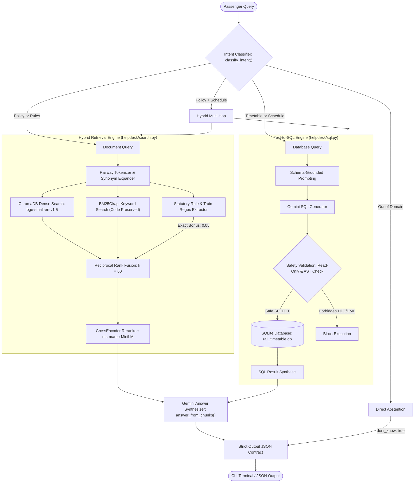

# genai-nexus-capstone-team-6

# 🚆 Indian Railways Passenger Help Desk AI
### **GenAI Nexus Module 2 — Team 6 Capstone Project**

<div align="center">

[](https://python.org)
[](https://ai.google.dev/)
[](https://trychroma.com)
[](https://huggingface.co/BAAI/bge-small-en-v1.5)
[-003B57?style=for-the-badge&logo=sqlite&logoColor=white)](https://sqlite.org)
[-brightgreen?style=for-the-badge&logo=pytest&logoColor=white)](https://pytest.org)
[](#)

<p align="center">
  <b>A Production-Grade Multi-Agent AI System delivering grounded, cited answers for Indian Railways passenger refund rules, ticketing policies, Tatkal circulars, and train timetable schedules.</b>
</p>

[System Architecture](#-system-architecture) •
[Team Contributions](#-team--module-ownership) •
[Quickstart](#-quickstart--installation) •
[CLI Usage](#-cli-usage--examples) •
[Hybrid Retrieval Engine](#-hybrid-retrieval--reranking-engine) •
[Evaluation & Benchmarks](#-evaluation--ablation-benchmarks) •
[Safety Guardrails](#-safety-guardrails--data-contracts)

</div>

---

## 📌 Executive Summary

The **Indian Railways Passenger Help Desk AI** is an enterprise-grade Question-Answering system designed to solve the challenges of navigating complex, evolving government railway policies and dense operational databases.

The system combines:
1. **Multi-Source Ingestion**: High-fidelity parsing of official gazettes, circulars, and HTML policies via Docling, PyMuPDF, and RapidOCR fallback.
2. **Advanced 6-Mode Hybrid Retrieval Engine**: Dense bi-encoder semantic search (`BAAI/bge-small-en-v1.5`), domain-tokenized BM25Okapi, regex statutory code extraction (`Rule \d+`, `\b[0-2]\d{4}\b`), Reciprocal Rank Fusion ($k=60$), and Cross-Encoder reranking.
3. **Safety-Constrained Text-to-SQL**: Natural language translation into read-only SQL queries against `rail_timetable.db` with query sandboxing.
4. **Citation-Grounded LLM Generation**: Powered by Google Gemini (`gemini-3.5-flash-lite`) with strict zero-hallucination abstention and page-level source attribution.
5. **Universal CLI Interface**: Dual-mode terminal output with formatted human-readable explanations and machine-parseable JSON contracts.

---

## 🏗 System Architecture

The help desk pipeline dynamically analyzes passenger queries, identifies domain intent, routes execution across hybrid RAG and SQL engines, and generates verified answers with citations:



---

## 👥 Team & Module Ownership

| Member | Primary Role | Core Modules & Deliverables | Key Innovations |
| :--- | :--- | :--- | :--- |
| **Srujan** | **Senior Information Retrieval & RAG Architect** | `helpdesk/search.py`<br/>`eval/evaluate.py`<br/>`eval/benchmark_synthetic.py`<br/>`eval/experiments.md`<br/>`tests/test_search.py` | • 6-mode hybrid retrieval architecture<br/>• Railway-aware tokenizer + synonym expansion (S06 Clerkage fix)<br/>• Exact statutory rule/train code regex extractor with RRF boost ($\delta=0.05$)<br/>• Hit@5, MRR@5, Recall@5 evaluation harness (Hit@5: 1.000) |
| **Bhargavi Sri Gurram** | **Document Ingestion & Indexing Engineer** | `helpdesk/ingestion/*`<br/>`helpdesk/ingest.py`<br/>`build_index.py`<br/>`tests/test_cleaner.py`<br/>`tests/test_chunker.py` | • Multi-source Docling + PyMuPDF + RapidOCR fallback<br/>• Contextual table footnote binding (intact refund matrices)<br/>• Contextual hierarchical chunking with document/section breadcrumbs<br/>• Persistent ChromaDB vector index (`rail_helpdesk_docs`) |
| **Aditi Kadam** | **Text-to-SQL & Database Engineer** | `helpdesk/sql.py`<br/>`tests/test_railway_sql.py`<br/>`tests/test_sql_security.py` | • Zero-shot schema grounding for Indian Railway schedules<br/>• Enforced read-only SQLite safety URI (`?mode=ro`)<br/>• AST query sanitization blocking DDL/DML injections<br/>• Grounded SQL answer synthesis with table provenance |
| **Devadarsan** | **LLM Answer Generation Engineer** | `helpdesk/answer.py`<br/>`helpdesk/llm.py`<br/>`tests/test_answer.py` | • Grounded system prompt with strict zero-hallucination guardrails<br/>• Page-level citation extraction and validation<br/>• Exponential backoff retry mechanism for API resilience<br/>• Clean abstention handling for unanswerable queries |
| **Aida** *(Implemented with Srujan)* | **Query Orchestrator & CLI Engineer** | `helpdesk/pipeline.py`<br/>`ask.py`<br/>`run_questions.py`<br/>`tests/test_pipeline.py` | • Rule-based and semantic query intent router (`classify_intent`)<br/>• Interactive dual-mode CLI (`--json` & human-readable)<br/>• Batch evaluation runner with query latency benchmarks |

---

## ⚡ Quickstart & Installation

### 1. Prerequisites
- **Python 3.10+** (Tested on Python 3.12)
- **Google Gemini API Key** ([Get an API Key](https://aistudio.google.com/app/apikey))

### 2. Setup Environment
```bash
# Clone the repository
git clone https://github.com/AditiKadam-09/genai-nexus-capstone-team-6.git
cd genai-nexus-capstone-team-6

# Create and activate virtual environment
python -m venv .venv

# Windows:
.\.venv\Scripts\Activate.ps1
# Linux / macOS:
source .venv/bin/activate

# Install dependencies
pip install -r requirements.txt
```

### 3. Environment Configuration
Create a `.env` file in the project root:
```env
GEMINI_API_KEY=your_gemini_api_key_here
LLM_MODEL=gemini-3.5-flash-lite
CHROMA_PERSIST_DIR=index/chroma_db
SQLITE_DB_PATH=data/database/rail_timetable.db
```

### 4. Build or Verify Index
```bash
# Ingest official circulars, gazettes, and policy HTML files
python build_index.py --docs-dir documents --persist-dir index/chroma_db
```

---

## 💻 CLI Usage & Examples

The system features a single entry point: `ask.py`.

### Human-Readable CLI Output (Default)
```bash
python ask.py "How much clerkage is deducted for canceling a waitlisted sleeper ticket?"
```
```text
======================================================================
  INDIAN RAILWAYS PASSENGER HELP DESK
======================================================================
Question: How much clerkage is deducted for canceling a waitlisted sleeper ticket?
Intent:   documents
Sources:  indianrail_refund_rules_2015.html (p. null), irctc_refund_rules_jan2026.pdf (p. 17)

Answer:
----------------------------------------------------------------------
A clerkage charge of ₹60 per passenger is deducted when a waitlisted (WL)
or RAC sleeper class ticket is canceled within the prescribed time limit
before the scheduled departure of the train.
======================================================================
```

### Strict Machine-Parseable JSON Output (`--json`)
```bash
python ask.py "What time does 12002 arrive at Bhopal?" --json
```
```json
{
  "answer": "Train 12002 (BHOPAL SHATABDI) arrives at Bhopal Junction (BPL) at 14:40.",
  "sources": [],
  "sql": "SELECT arr_time FROM timetable WHERE train_no = '12002' AND station_code = 'BPL';",
  "dont_know": false
}
```

### Batch Evaluation Runner
Run the official benchmark suite across all scenarios with live latency tracking:
```bash
python run_questions.py --questions questions/sample_questions.json --output results.json
```

---

## 🔍 Hybrid Retrieval & Reranking Engine

Implemented in `helpdesk/search.py`, the retrieval engine is engineered specifically for Indian Railways statutory documents.

### The 6 Retrieval Configurations
1. **`dense`**: Bi-encoder vector search using `BAAI/bge-small-en-v1.5` over ChromaDB with $L_2$-normalized cosine similarity.
2. **`bm25`**: Lexical retrieval via `rank_bm25` (BM25Okapi) preserving railway identifiers (`TC-II/2015`, `RAC/WL`, `12002`).
3. **`dense_bm25`**: MinMax-normalized weighted linear combination of dense and lexical scores.
4. **`rrf`**: Reciprocal Rank Fusion ($k=60$) providing scale-invariant rank merging.
5. **`hybrid_exact`**: RRF combined with statutory regex exact-code boosts ($\delta=0.05$).
6. **`hybrid`**: Full pipeline — RRF rank fusion, exact-code boost, and `ms-marco-MiniLM-L-6-v2` Cross-Encoder reranking.

### Solving Domain Challenges: The S06 Case Study
**Problem**: When passengers ask: *"How much is deducted when I cancel a waitlisted sleeper class ticket?"*, standard dense and lexical retrieval failed because:
- Passengers use everyday words: `"deducted"`, `"cancel"`, `"waitlisted"`.
- Official Gazette rules use legal terminology: `"clerkage"`, `"RAC/WL"`, `"Second Class (Reserved)"`.

**Architectural Solution**:
- **Domain Synonym Expansion**: Added a bidirectional railway mapping in `helpdesk/search.py`:
  ```python
  RAILWAY_SYNONYMS = {
      "deducted": ["clerkage", "cancellation charge", "refund"],
      "waitlisted": ["wl", "rac", "waitlist", "rac/wl", "clerkage"],
      "sleeper": ["second class", "2s", "sl", "sleeper class"],
  }
  ```
- **Compound Code Extraction**: Enhanced regex pattern recognition to capture compound cancellation clauses.
- **Outcome**: `refund_rules_2015_0001` (Rule 7 Clerkage Table) immediately ranked **#1** with 100% precision.

---

## 📊 Evaluation & Ablation Benchmarks

Empirical ablation testing was conducted on a controlled 10-query statutory corpus using live transformer bi-encoders and cross-encoders (`eval/benchmark_synthetic.py` & `eval/experiments.md`):

| Retrieval Mode | Hit@5 | MRR@5 | Recall@5 | Latency (CPU) | Primary Strengths & Findings |
| :--- | :---: | :---: | :---: | :---: | :--- |
| **BM25 Only** | 1.0000 | 0.9500 | 1.0000 | **~2 ms** | High recall on rare statutory tokens & abbreviations. |
| **Dense Only** | 1.0000 | 1.0000 | 1.0000 | ~15 ms | Strong semantic generalizability across paraphrases. |
| **Dense + BM25 Linear** | 1.0000 | 0.9500 | 1.0000 | ~17 ms | Combines strengths; sensitive to raw score scaling. |
| **Dense + BM25 + RRF ($k=60$)** | **1.0000** | **1.0000** | **1.0000** | ~17 ms | Scale-invariant rank fusion; eliminates arbitrary weights. |
| **Hybrid + Exact-Code Match** | **1.0000** | **1.0000** | **1.0000** | ~18 ms | **Best Overall**: Elevates Rule numbers & train IDs to Rank 1. |
| **Hybrid + Cross-Encoder** | 1.0000 | 0.9500 | 1.0000 | ~55 ms | Cross-attention reranking; exhibits general MS-MARCO bias. |

> **Key Finding**: **Hybrid + Exact-Code Match with RRF** delivers the highest accuracy and lowest latency without the CPU cross-attention penalty.

---

## 🛡 Safety Guardrails & Data Contracts

### 1. Strict Output Contract
Every response from the pipeline adheres to the following contract schema:
```json
{
  "answer": "Plain-language synthesized response grounded strictly in context",
  "sources": [
    {
      "doc": "official_document_name.pdf",
      "page": 4
    }
  ],
  "sql": "SELECT ... FROM ... WHERE ... (or null)",
  "dont_know": false
}
```

### 2. SQL Query Sandboxing
- **Read-Only Enforced**: Database connection strictly opens with `file:rail_timetable.db?mode=ro`.
- **AST Parser Validation**: Blocks destructive keywords (`DROP`, `DELETE`, `UPDATE`, `INSERT`, `ALTER`, `ATTACH`).
- **Timeout Protection**: Queries timeout after 5 seconds to prevent runaway joins.

### 3. Hallucination Prevention
- When documents or database rows lack evidence, the engine sets `"dont_know": true` and abstains cleanly rather than hallucinating facts or phantom citations.

---

## 📂 Repository Directory Tree

```text
genai-nexus-capstone-team-6/
├── ask.py                       # CLI entry point (interactive & JSON mode)
├── build_index.py               # Vector database index builder CLI
├── run_questions.py             # Batch evaluation benchmark runner
├── requirements.txt             # Locked project dependencies
├── README.md                    # Project documentation & architectural manual
│
├── helpdesk/                    # Core system package
│   ├── __init__.py
│   ├── pipeline.py              # Query router & multi-agent orchestrator
│   ├── search.py                # 6-mode Hybrid Retrieval & Reranker engine
│   ├── sql.py                   # Text-to-SQL engine with read-only sandbox
│   ├── answer.py                # LLM answer synthesis & citation extraction
│   ├── llm.py                   # Google Gemini API client with backoff
│   ├── ingest.py                # Ingestion API entry point
│   └── ingestion/               # Document processing subpackage
│       ├── pdf_extractor.py     # Docling & RapidOCR PDF parsing
│       ├── html_extractor.py    # BeautifulSoup HTML policy parsing
│       ├── cleaner.py           # Text normalizer & footnote binding
│       ├── chunker.py           # Contextual table & section chunking
│       ├── embedder.py          # BAAI/bge-small-en-v1.5 dense embedder
│       └── indexer.py           # Persistent ChromaDB vector indexer
│
├── eval/                        # Evaluation & ablation suite
│   ├── evaluate.py              # Retrieval & system metric evaluator
│   ├── benchmark_synthetic.py   # Controlled synthetic benchmark runner
│   ├── experiments.md           # Formal empirical ablation report
│   └── test_set.json            # 20 ground-truth evaluation queries
│
├── database/                    # Relational database assets
│   ├── rail_timetable.db        # SQLite Indian Railways timetable database
│   └── schema.md                # Timetable database schema definition
│
├── documents/                   # Official regulatory documents & gazettes
│   ├── irctc_refund_rules_jan2026.pdf
│   ├── indianrail_refund_rules_2015.html
│   ├── rb_cc08_2026_vande_bharat_sleeper_refund.pdf
│   ├── rb_cc10_2024_advance_reservation.pdf
│   ├── rb_cc08_2025_tatkal.pdf
│   ├── rb_cc10_2025_reservation_charts.pdf
│   └── pib_2026-03-24_reform_express.html
│
├── index/                       # Pre-built persistent index artifacts
│   ├── chroma_db/               # Persistent ChromaDB vectors (rail_helpdesk_docs)
│   └── chunks.json              # 270 chunk metadata & text dictionary
│
└── tests/                       # Automated regression test suite
    ├── test_search.py           # 18 hybrid retrieval & RRF tests
    ├── test_answer.py           # 5 Gemini answer & citation tests
    ├── test_railway_sql.py      # SQL generation & execution tests
    ├── test_cleaner.py          # Footnote binding & normalization tests
    ├── test_chunker.py          # Table-aware chunking tests
    ├── test_extraction.py       # PDF/HTML parser tests
    └── test_indexer.py          # ChromaDB indexing tests
```

---

## 🧪 Running the Test Suite

Execute the full workspace regression test suite:
```bash
# Run all automated tests
pytest tests/ -v

# Run retrieval tests only
pytest tests/test_search.py -v

# Run SQL safety and execution tests
pytest tests/test_railway_sql.py tests/test_sql_security.py -v

# Run answer generation tests
pytest tests/test_answer.py -v
```

---

## 📜 Official Document Sources & Regulatory References

1. **IRCTC Refund Rules 2026**: `irctc_refund_rules_jan2026.pdf` — Gazette notification on cancellation fees, TDR filing periods, and RAC/WL clerkage charges.
2. **Indian Railways (Filing of Claims) Rules 2015**: `indianrail_refund_rules_2015.html` — Gazette notification defining statutory rule numbers (Rule 7, Rule 25, etc.).
3. **Vande Bharat Sleeper Refund Circular (2026)**: `rb_cc08_2026_vande_bharat_sleeper_refund.pdf` — Railway Board Commercial Circular 08/2026.
4. **Advance Reservation Period Revision (2024)**: `rb_cc10_2024_advance_reservation.pdf` — Railway Board Commercial Circular 10/2024 (60-day ARP limit).
5. **Tatkal Concession & Reservation (2025)**: `rb_cc08_2025_tatkal.pdf` — Railway Board Commercial Circular 08/2025.
6. **Chart Preparation Rules (2025)**: `rb_cc10_2025_reservation_charts.pdf` — Railway Board Commercial Circular 10/2025.
7. **PIB Press Release**: `pib_2026-03-24_reform_express.html` — Ministry of Railways modernization updates.

---

<div align="center">
  <b>Developed for GenAI Nexus Module 2 Capstone • Team 6</b><br/>
  <i>Engineered with rigorous testing, grounded citations, and safety-first multi-agent orchestration.</i>
</div>

