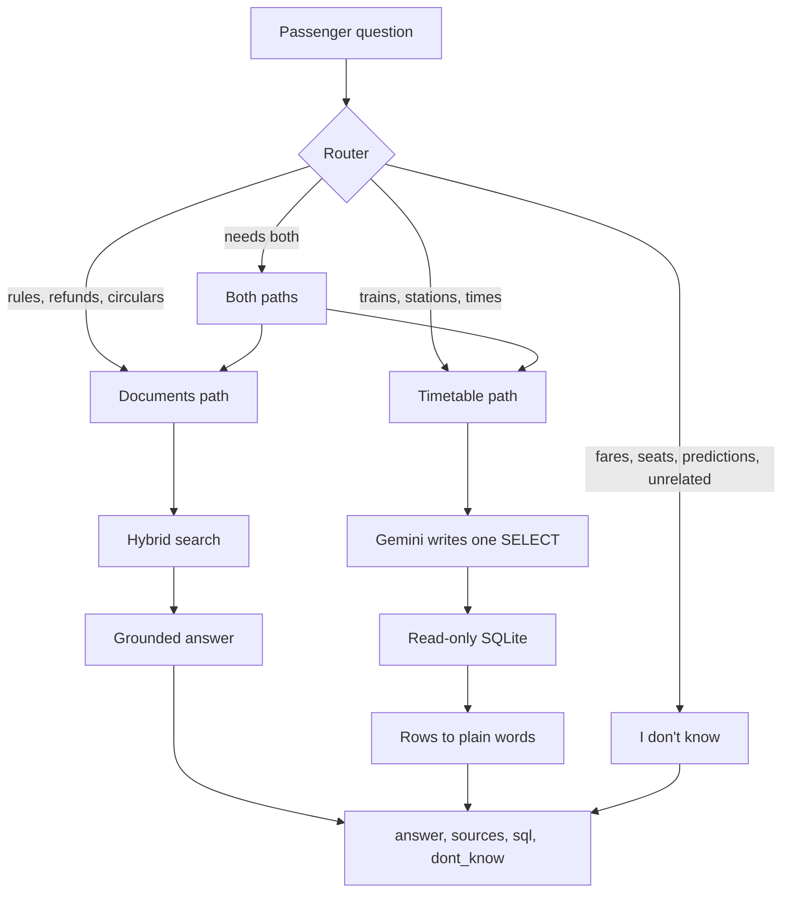

# 🚆 Railway Passenger Help Desk

### GenAI Nexus, Cohort 1, Module 2 Capstone: Team 6

<div align="center">

[](https://python.org)
[](https://ai.google.dev/)
[](https://trychroma.com)
[](https://huggingface.co/BAAI/bge-small-en-v1.5)
[-003B57?style=for-the-badge&logo=sqlite&logoColor=white)](https://sqlite.org)
[](#)

<p align="center">
  <b>A command-line help desk that answers Indian Railways passenger questions only from the data pack, with the document and page (or the SQL) behind every answer.</b>
</p>

[What it returns](#-what-it-returns) •
[Install and run](#-install-and-run) •
[Using it](#-using-it) •
[How it works](#-how-it-works) •
[Grounding](#-keeping-answers-grounded) •
[Evaluation](#-evaluation) •
[Tests](#-tests) •
[Team](#-team)

</div>

---

> An unofficial learning project built on public government documents and an open (CC0) timetable. Not affiliated with Indian Railways or IRCTC.

## 📌 Summary

The help desk answers questions from three kinds of data: refund and cancellation rules, Railway Board circulars, a PIB press release, and a 2016 timetable database. It says "I don't know" when the data cannot answer.

- **Ingestion**: Docling, RapidOCR fallback and BeautifulSoup, with structure-aware chunking.
- **Hybrid search**: six modes combining dense (`BAAI/bge-small-en-v1.5`), BM25, exact-code matching, Reciprocal Rank Fusion (k = 60) and a cross-encoder reranker.
- **Grounded answers**: Gemini (`gemini-3.5-flash-lite`, temperature 0) sees only the retrieved passages, and sources are built by code, not typed by the model.
- **Read-only text-to-SQL** for timetable questions, with layered safety checks.
- **Router** that sends each question to documents, the database, both, or a clean "I don't know".

## 📤 What it returns

Every question goes through one function, `ask(question)` in `helpdesk/pipeline.py`, which always returns:

```json
{
  "answer": "the reply, in plain words",
  "sources": [{"doc": "irctc_refund_rules_jan2026.pdf", "page": 2}],
  "sql": "SELECT ... or null",
  "dont_know": false
}
```

- `sources` lists the documents and pages the answer is based on. `page` is `null` for web pages.
- `sql` holds the query for timetable answers, and is `null` otherwise.
- `dont_know` is `true` when the system declines (no evidence, a request it must not fulfil, or a question the data cannot answer).

## ⚡ Install and run

Run every command from the repository root. Python 3.10 or newer.

**1. Clone, create an environment and install**

```bash
git clone https://github.com/AditiKadam-09/genai-nexus-capstone-team-6.git
cd genai-nexus-capstone-team-6

python -m venv .venv
# Windows (PowerShell):  .\.venv\Scripts\Activate.ps1
# Linux / macOS:         source .venv/bin/activate
pip install -r requirements.txt
```

The install is large (PyTorch and Docling). The first run also downloads two small search models from Hugging Face (about 200 MB), so it needs internet.

**2. Add the data pack**

Unzip `rail_capstone_pack.zip` into a folder named `data/`, so the files end up in `data/rail_capstone_pack/...` (for example `data/rail_capstone_pack/database/rail_timetable.db`). The pack is not committed to this repository.

**3. Add your Gemini key**

Copy `.env.example` to `.env` and put your own key after `GEMINI_API_KEY=` ([get a key](https://aistudio.google.com/app/apikey)). The key stays in `.env` and is never committed. A free key allows about 15 requests per minute; when the limit is reached the client prints a message, waits, and retries automatically.

**4. The search index**

The index is already built and committed in `index/` (`chunks.json` and `chroma_db/`), so nothing needs to be built. To rebuild it from the pack (a few minutes on a CPU):

```bash
python build_index.py --reindex
```

## 💻 Using it

```bash
python ask.py                          # interactive: type a question, press Enter, type exit to quit
python ask.py "your question"          # one question, readable answer
python ask.py --json "your question"   # one question, raw JSON
python run_questions.py <questions.json> <results.json>   # many questions
```

`run_questions.py` reads a JSON list of `{"id": ..., "question": ...}` objects and writes a JSON list with one object per question: `id`, `question`, `answer`, `sources`, `sql`, `dont_know`. It saves after every question and pauses briefly between questions to respect the rate limit.

### Examples (real output)

A rules question:

```text
$ python ask.py "If I cancel my confirmed Vande Bharat Sleeper ticket 10 hours before departure, how much do I lose?"

ANSWER:
... the cancellation charge shall be fifty per cent. of the fare. Therefore, you will lose 50% of the fare.

SOURCES:
  - rb_cc08_2026_vande_bharat_sleeper_refund.pdf (page 5)
  - irctc_refund_rules_jan2026.pdf (page 2)
```

A timetable question (the SQL is shortened here):

```text
Question> Where does the Bhopal Shatabdi (12002) stop between New Delhi and Bhopal, and where does it stop longest?

ANSWER:
Between New Delhi and Bhopal, the Bhopal Shatabdi (12002) stops at Mathura Jn (arrival 07:32, departure 07:34, halt 2 minutes), Agra Cantt (arrival 08:12, departure 08:17, halt 5 minutes), Morena (arrival 09:00, departure 09:02, halt 2 minutes), Gwalior Jn (arrival 09:35, departure 09:38, halt 3 minutes), and Jhansi Jn (arrival 10:48, departure 10:56, halt 8 minutes). It stops longest at Jhansi Jn, with a halt of 8 minutes.

This answer is from the 2016 timetable in the data pack.

SQL:
SELECT st.name, s.arrival, s.departure, s.halt_min
FROM stops a
JOIN stops s ON ...
ORDER BY s.stop_sequence
```

A question the data cannot answer:

```text
Question> Which platform does the Mumbai Rajdhani leave from?

ANSWER:
I don't know. The timetable in my data does not contain that information.

(dont_know: true - the system could not answer this from its data)
```

Raw JSON for a simple timetable lookup:

```json
{
  "answer": "The name of train 12430 is Delhi H Nizamuddin-Bangalore Rajdhani Express.  This answer is from the 2016 timetable in the data pack.",
  "sources": [],
  "sql": "SELECT name FROM trains WHERE number = '12430'",
  "dont_know": false
}
```

## 🏗 How it works



### 1. Documents in (ingestion)

- Docling reads the PDFs (headings, paragraphs, tables); pages without a text layer are read with RapidOCR. HTML pages are read with BeautifulSoup.
- Each document has a date (from the pack's `SOURCES.md`), kept with every chunk so that the newer rule can win.
- Chunks follow the document structure: sections split at headings and at page boundaries, so each chunk carries the page its text is really on. Tables are kept as Markdown with the header row repeated, footnotes stay with their table, and the sentence just before a table (its condition) is kept with it. Long text is cut at 1,500 characters with 150 characters of overlap; a single oversized table row is cut like ordinary text.
- Every chunk stores `doc`, `page` (`null` for web pages), `date` and the section path, in `index/chunks.json` and in the ChromaDB collection `rail_helpdesk_docs`. Embeddings use `BAAI/bge-small-en-v1.5`.

### 2. Search

`helpdesk/search.py` supports six modes: `dense`, `bm25`, `dense_bm25`, `rrf`, `hybrid_exact` and `hybrid` (the default used by the pipeline).

- **Dense** search over ChromaDB, **BM25** keyword search with a railway-aware tokenizer and a small synonym map (for example "deducted" and "clerkage"), and **exact-code matching** for things like "Rule 25" and five-digit train numbers.
- The rankings are merged with Reciprocal Rank Fusion (k = 60), with a small bonus for exact-code matches, and the top candidates are reranked with the cross-encoder `ms-marco-MiniLM-L-6-v2`.

### 3. Answers

`helpdesk/answer.py` gives Gemini (`gemini-3.5-flash-lite`, temperature 0) the five best passages, each with its document, page and date, and a strict prompt:

- answer only from the passages, never from general knowledge;
- if two passages disagree, **the newer document wins**, and the answer says it overrides the older rule;
- apply a rule only when its conditions (train type, class, time window) match the question;
- if the passages do not contain the answer, say so.

The model only cites chunk IDs. The code then builds `sources` (document and page) from the chunk metadata, so a document name or page number is never typed by the model.

### 4. Timetable questions (text-to-SQL)

`helpdesk/sql.py` reads the real schema from the database, adds generic query patterns (trains between two stations, journey time, halts) to the prompt, and asks Gemini for one SELECT query. Station names are matched exact-name-first with a LIKE fallback.

- If the query fails, or returns no rows, the error is sent back to Gemini for up to two corrections.
- The prompt has two special replies: `REFUSE` (a request to change or delete data) and `NO_DATA` (fares, seat availability, live status and similar). Both produce a polite answer with `dont_know: true`.
- The returned rows, and nothing else, are turned into a plain-language answer. The SQL is returned in the `sql` field.

**Safety layers** (any one of them can block a bad query):

1. the database file is opened read-only (`mode=ro`);
2. a SQLite authorizer allows reads of the timetable tables only, and blocks writes, `sqlite_master` and dangerous functions;
3. only a single SELECT (or WITH) statement is accepted, and destructive keywords are rejected;
4. a 5-second time limit and a 50-row cap.

### 5. Routing

`helpdesk/pipeline.py` decides where a question goes:

- **Keywords first.** A train number or words like "timetable" and "station" send a question to the database; words like "refund", "cancel", "Tatkal" and "rule" send it to the documents. This costs no Gemini call.
- **Gemini router for the rest.** If a question has both kinds of words, or neither, a Gemini call returns the route (`documents`, `database`, `both` or `none`). For a mixed question it also splits it into two standalone questions, one for each path. If Gemini is unavailable, the keywords decide.
- **`none`** is used for what the data can never answer (fares, seat availability, live status, predictions such as whether a waitlisted ticket will be confirmed, and unrelated questions). This is decided from the question alone, without looking at any passages. A second safety net remains: the answer step also declines when the retrieved passages do not support the question.
- For `both`, the two answers are merged. `ask()` never raises an error: any failure becomes an answer with `dont_know: true`.

The router does not compute a numeric confidence score.

## 🛡 Keeping answers grounded

No system can promise zero mistakes, so these are the controls we use and test:

- answers come only from retrieved passages or from SQL rows, and the prompts forbid adding facts;
- sources are built by code from chunk metadata, never typed by the model;
- the newer document wins when rules conflict;
- the system declines (`dont_know: true`) when there is no evidence, for questions outside the data, and for requests to change data;
- temperature 0, and a retry with growing waits for rate limits and temporary service errors;
- we check the behaviour on unanswerable and harmful questions in `eval/test_set.json`.

## 📊 Evaluation

`eval/test_set.json` holds 28 labelled questions: the 10 sample questions from the pack, 13 questions checked against the documents or the database, and 5 timetable questions (including unanswerable and harmful ones). Document questions are labelled with the document and page that contain the answer.

`eval/evaluate.py` measures Hit@5, MRR@5 and Recall@5 for each of the six search modes, plus end-to-end answer accuracy, source correctness and abstention accuracy on the first 10 questions. Full tables, the before/after comparison and the limits of this evaluation are in [`eval/experiments.md`](eval/experiments.md).

In short:

- Hit@5 is 1.0 for every search mode on this test set, so it cannot rank them. MRR@5 lies between about 0.82 and 0.93 depending on the mode, and the cross-encoder reranker did not improve it.
- Raising the chunk size from 500 to 1,500 characters raised the average Recall@5 over the six modes from about 0.91 to 0.98. The end-to-end figures were 1.0 in both runs on the first 10 questions, so the change was justified by answer failures we found by hand: with 500-character chunks a Vande Bharat rule was cut into three fragments and two of the ten sample questions were answered wrongly.
- These figures come from a small test set and are not a general accuracy claim.

To run the evaluation (it uses Gemini for the end-to-end part, and writes a report; give it your own output path so that it does not overwrite `eval/experiments.md`):

```bash
python eval/evaluate.py --output-md eval/my_run.md
```

## 🧪 Tests

```bash
python -m pytest tests/test_answer.py tests/test_chunker.py tests/test_cleaner.py -q

# Text-to-SQL tests (run as modules; they need the pack unzipped into data/)
python -m tests.test_answer_sql
python -m tests.test_sql_security
python -m tests.test_sql_edge_cases
python -m tests.test_sql_prompt
python -m tests.test_sql_module
python -m tests.test_sql_mock
python -m tests.test_railway_sql
```

The tests for search, extraction, indexing and ingestion (`tests/test_search.py`, `test_extraction.py`, `test_indexer.py`, `test_ingest.py`) need the full requirements installed and the index present. The SQL tests use fake model replies, so they need no key.

## 📂 Repository layout

```text
ask.py                  CLI: interactive mode, one question, or --json
run_questions.py        batch runner used for the hidden questions
build_index.py          builds the search index (optional, the index is committed)
requirements.txt        pinned dependencies
.env.example            GEMINI_API_KEY= and settings (copy to .env)

helpdesk/
  pipeline.py           ask(): routing and merging
  search.py             six search modes, tokenizer, exact codes, reranker
  answer.py             grounded answers from passages
  sql.py                read-only text-to-SQL
  llm.py                Gemini client with wait-and-retry
  ingest.py             ingestion entry point
  ingestion/            pipeline that turns the pack into chunks and an index
ingestion/              extractors, cleaner, chunker, embedder, indexer and settings
                        (imported by helpdesk/ingestion/pipeline.py)

index/
  chunks.json           all chunks with document, page, date and section
  chroma_db/            ChromaDB vector index (collection rail_helpdesk_docs)

eval/
  test_set.json         28 labelled questions
  evaluate.py           retrieval and end-to-end evaluation
  experiments.md        results and before/after comparison
  benchmark_synthetic.py  small synthetic smoke benchmark (not used for the reported results)

tests/                  unit tests (see "Tests")
```

## 👥 Team

| Member | Primary role | Contribution |
| :--- | :--- | :--- |
| **Bhargavi Sri Gurram** | Document Ingestion & Indexing Engineer | Docling and RapidOCR extraction, cleaning, footnote binding, chunking, embeddings, ChromaDB index (`helpdesk/ingestion/`, `ingestion/`, `build_index.py`). |
| **Srujan** | Information Retrieval & Evaluation | The six search modes, tokenizer and synonyms, exact-code matching, reranker, and the evaluation harness (`helpdesk/search.py`, `eval/evaluate.py`). |
| **Devadarsan** | LLM Answer Generation Engineer | Gemini client with retries, the grounded answer prompt, abstention (`helpdesk/llm.py`, `helpdesk/answer.py`). |
| **Aditi Kadam** | Text-to-SQL, Pipeline & CLI | Read-only text-to-SQL and its tests (`helpdesk/sql.py`); the final pipeline, CLI and batch runner (`helpdesk/pipeline.py`, `ask.py`, `run_questions.py`); chunking fixes (page-accurate sections, table lead-in sentences, dates); the 28-question test set. |
| **Aida** *(with Srujan)* | Query Orchestrator & CLI Engineer | Query routing and the command-line interface, including the interactive mode, the `--json` and readable output modes, and the batch runner (`helpdesk/pipeline.py`, `ask.py`, `run_questions.py`). |

## ⚠️ Known limitations

- The timetable is a **2016 snapshot**. It has no platform numbers, fares or seat availability, and it contains no newer trains.
- There is no numeric routing confidence; routing uses keywords and a Gemini router (see "Routing").
- The test set is small (28 questions) and Hit@5 is saturated, so it separates the search modes poorly. End-to-end metrics cover only the first 10 questions.
- Text extracted from some PDFs loses the space at a line break (for example "betweenseventy-two"); the numbers are not affected.
- The free Gemini key allows about 15 requests per minute, so a long run can pause while it waits and retries.

## 📜 Data sources

All documents are in the course data pack (`SOURCES.md` there lists the originals):

| File | What it is | Date used |
| :--- | :--- | :--- |
| `irctc_refund_rules_jan2026.pdf` | IRCTC refund rules and TDR filing | 2026-01-19 |
| `indianrail_refund_rules_2015.html` | Refund rules page with the pre-revised and revised (12 Nov 2015) tables | 2015-11-12 |
| `rb_cc08_2026_vande_bharat_sleeper_refund.pdf` | Railway Board Commercial Circular 08/2026 (gazette notification for Vande Bharat Sleeper refunds) | 2026-01-16 |
| `rb_cc10_2024_advance_reservation.pdf` | Railway Board Commercial Circular 10/2024 (advance reservation period) | 2024-10-16 |
| `rb_cc08_2025_tatkal.pdf` | Railway Board Commercial Circular 08/2025 (Tatkal booking and Aadhaar authentication) | 2025-06-10 |
| `rb_cc10_2025_reservation_charts.pdf` | Railway Board Commercial Circular 10/2025 (reservation charts) | 2025-07-02 |
| `pib_2026-03-24_reform_express.html` | PIB press release, "Reform Express" | 2026-03-24 |
| `rail_timetable.db` | SQLite timetable (2016 snapshot, open CC0 data) | n/a |

---

<div align="center">
  <b>Developed for GenAI Nexus Module 2 Capstone • Team 6</b>
</div>